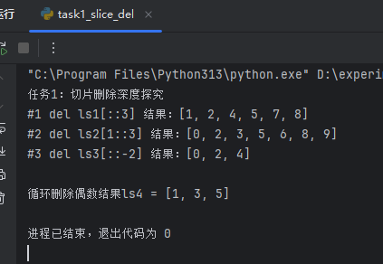
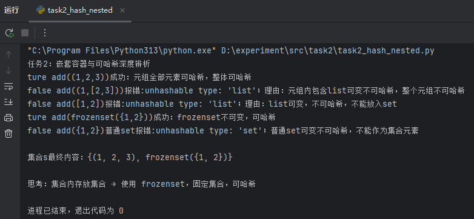
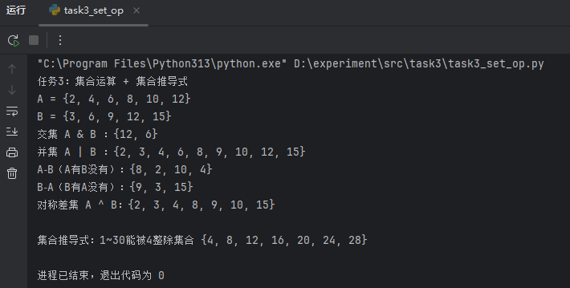
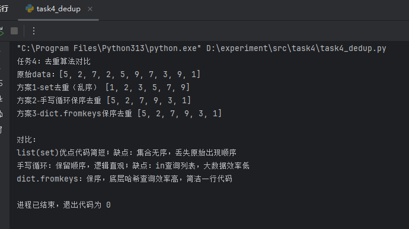
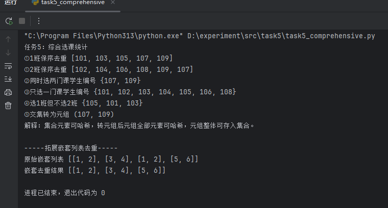

# Python列表、元组、集合实验报告
**适用课程：Python程序设计**
实验学时：2学时
实验类型：验证＋综合设计＋分析探究型

## 一、实验目的
1. 深入掌握列表、元组、集合底层特性：可变／不可变、可哈希判定规则，区分“引用不可变”和“元素内容不可变”；
2. 精通切片语法、步长正负、del切片删除的底层执行逻辑，理解切片删除时索引的计算陷阱；
3. 熟练运用集合交、并、差、对称差运算，掌握集合推导式、列表推导式；
4. 能够处理嵌套列表、嵌套元组，准确判断嵌套对象是否可哈希；
5. 理解集合去重丢失顺序问题，实现保留原始顺序的去重算法；
6. 具备代码排错能力，独立分析TypeError: unhashable type、切片删除预期不符等疑难问题；
7. 根据需求自主选择容器，完成小型综合数据处理任务。

## 二、实验环境
1. Python3.x
2. VSCode/PyCharm，无第三方库依赖

## 三、实验原理
1. list列表：动态数组，存储对象引用；del 列表[切片]原地批量删除；遍历同时删除会漏删。
2. tuple元组：不可变是**引用地址不可变**；元组里面可以放list，list内部可以修改；只要任意一个元素不可哈希，整个元组不可哈希。
3. set集合：哈希表实现；& | - ^ 交并差对称差；普通set可变，不能嵌套；frozenset固定集合可哈希，可以放进集合。
4. 可哈希：对象生命周期hash值不变；可变对象list、set不可哈希；int str tuple frozenset可哈希。
5. 去重：`list(set(data))`简洁但乱序；保序去重可以手写循环，或者dict.fromkeys。

## 四、实验步骤与源代码
> 源代码放在src目录下，分为task1‑task5，分别运行。
### 运行结果截图
> 截图文件存放在 `report/screenshots/`











### 任务1 切片删除深度探究
|代码|预判结果|实际运行结果|说明|
|----|--------|------------|----|
|del ls1[::3]|[1,2,4,5,7,8,9]|[1, 2, 4, 5, 7, 8]|删除原始索引0,3,6|
|del ls2[1::3]|[0,2,3,5,6,8,9]|[0, 2, 3, 5, 6, 8, 9]|删除原始索引1,4,7|
|del ls3[::-2]|[0,2,4]|[0,2,4]|负步长，取原始索引5,3,1删除|
|for循环remove删除偶数|[1,3,5]|[1,3,5,6]|出现漏删bug|

> bug解释：for迭代器跟随列表索引迭代；remove删除一个元素，列表后面元素整体向前移动一格，迭代器索引继续+1，跳过下一个元素，导致删不干净。
安全方案：遍历副本`for i in ls4[:]`，或者列表推导式生成新列表。

### 任务2 嵌套容器、可哈希辨析
1. `add((1,2,3))`成功，全部元素可哈希
2. `add((1,[2,3]))`报错 unhashable；元组包含list可变对象，整个元组不可哈希
3. `add([1,2])`报错；list可变不可哈希
4. `add(frozenset({1,2}))`成功，frozenset固定集合可哈希
5. `add({1,2})`普通set可变，不可哈希，不能放入集合。

> 如果集合内部存放集合：使用 frozenset。

### 任务3 集合运算、集合推导式
A={2,4,6,8,10,12},B={3,6,9,12,15}
- 交集A&B：{6, 12}
- 并集A|B：{2,3,4,6,8,9,10,12,15}
- A‑B：{8,2,4,10}
- B‑A：{3,9,15}
- A^B对称差：{2,3,4,8,9,10,15}
推导式生成1‑30能被4整除 {4, 8, 12, 16, 20, 24, 28}

### 任务4 去重算法对比
原始数据 [5,2,7,2,5,9,7,3,9,1]
1. list(set(data))：去重，但是顺序打乱，丢失第一次出现顺序。
2. 手写循环保序：遍历，不在新列表才append，保留原始顺序。
3. dict.fromkeys(data)：字典key自动去重，python3.7+字典有序，一行实现保序去重。
4. 手写循环保序优点逻辑易懂，缺点大数据下`in`查询效率低；`dict.fromkeys`底层哈希，执行效率更高。

### 任务5 综合选课
class1 = [101,103,105,107,109,103,101]
class2 = [102,104,106,108,109,107,102]
1. 保序去重：c1_unique = [101,103,105,107,109]；c2_unique=[102,104,106,108,109,107]
2. 同时选两门 {107, 109}
3. 只选一门 {101,102,103,104,105,106,108}
4. 选1班不选2班 {101,103,105}
5. 交集转元组 (107, 109)；集合元素全部可哈希，转为元组整体可哈希，可以存入集合。

拓展嵌套列表去重：内层list转tuple，集合去重，再转回list。

### 源代码片段
完整代码文件存放在项目`src/`目录，下面展示各任务核心代码片段。

#### 任务1核心代码
```python
ls1 = [0,1,2,3,4,5,6,7,8,9]
del ls1[::3]

ls4 = [1,2,3,4,5,6]
for i in ls4:
    if i % 2 == 0:
        ls4.remove(i)
```

#### 任务 2 核心代码
```python
s = set()
try:
    s.add((1,[2,3]))
except Exception as e:
    print(e)
```

#### 任务 3 核心代码
```python
A = {2,4,6,8,10,12}
B = {3,6,9,12,15}
print(A & B,A | B, A-B, B-A, A^B)
res = {x for x in range(1,31) if x%4 ==0}
```

#### 任务 4 核心代码
```python
data = [5,2,7,2,5,9,7,3,9,1]
res_set = list(set(data))
#手写保序
res_hand=[]
for num in data:
    if num not in res_hand:
        res_hand.append(num)
res_dict = list(dict.fromkeys(data))
```

#### 任务 5 核心代码
```python
class1 = [101,103,105,107,109,103,101]
class2 = [102,104,106,108,109,107,102]
c1_unique = list(dict.fromkeys(class1))
s1,s2 = set(class1),set(class2)
both = s1 & s2
only_one = s1 ^ s2
only_c1 = s1 - s2
t_both = tuple(both)
```

## 五、必答思考题
1. **del ls[::3]是按删除前索引计算还是动态实时索引？举例**
切片删除按照**删除之前原始列表索引一次性全部计算出来，不是动态实时索引**。例：del ls[::3]，先算出所有要删的下标0,3,6，再一次性批量删除，删除过程中索引不会动态变化。

2. **t=(1,[2,3])，为什么t[1].append(4)合法，但是t不能放入集合？**
元组不可变指**存储的引用地址不能变**；t[1]保存的是列表对象的地址，这个地址不能修改，但是列表对象本身是可变，可以append修改内部内容。
但是因为元组内部包含list（不可哈希对象），整个元组不可哈希，所以无法加入set。

3. **为什么普通set不能嵌套，frozenset可以作为集合元素？**
普通set可变，对象hash值会改变，不可哈希，不能做集合元素；frozenset是不可变固定集合，哈希值固定，可哈希，可以作为set的元素。

4. **for遍历列表同时remove为什么删不干净？安全修改方案**
删除元素，列表长度缩短，后续元素前移，迭代器索引继续+1，跳过下一个待处理元素。
安全方案：①遍历列表副本 for x in lst[:]；②列表推导式生成新列表；③while手动反向索引pop。

5. **list(set(数据))去重缺陷？保序去重实现方式？**
缺陷：集合无序，丢失原始数据第一次出现顺序。
保序去重：①手写循环判断；②dict.fromkeys(data)；③python3.8+ itertools‑recipes。

## 六、实验小结
1. list有序可变，支持增删改，适合频繁修改序列；**禁止遍历同时原地删除**。
2. tuple有序不可变（仅引用不可变）；全部元素可哈希的元组可以放入集合。
3. set无序可变，元素必须可哈希；适合去重、交并差集合运算；嵌套集合要用frozenset。
> 容器选型：需要顺序+可变选list；数据不修改、可哈希选tuple；需要去重集合运算选set；需要嵌套集合用frozenset。
