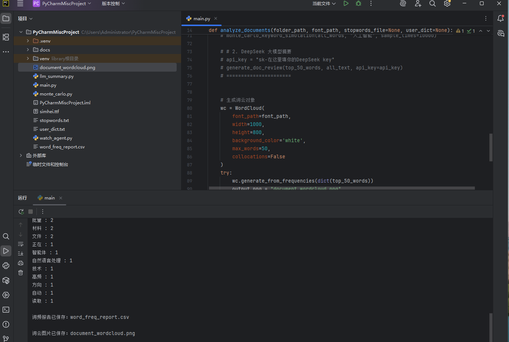
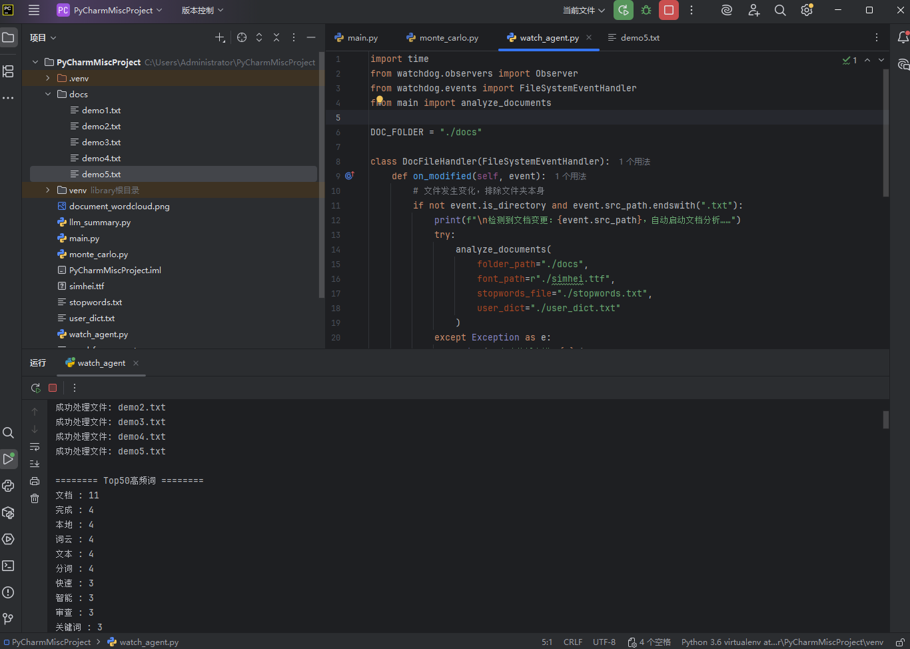
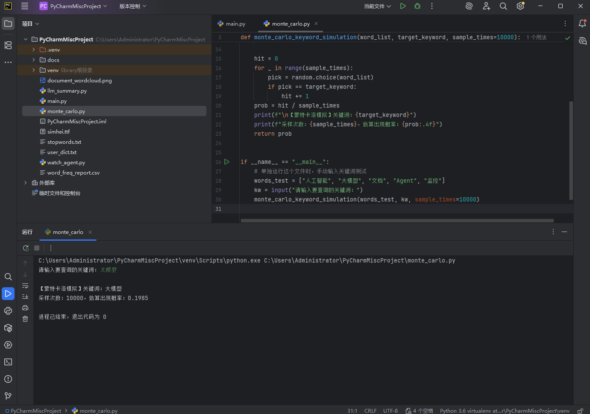
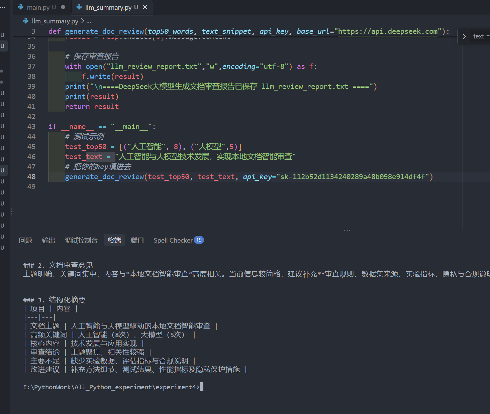

# 文档智能分析Agent系统实验报告
## 一、实验目的
1. 掌握中文分词、停用词过滤、词频统计的实现方法，使用jieba库完成文本预处理。
2. 掌握词云可视化，直观展示文档高频词汇。
3. 实现文件夹监控Agent，监测文档变更，自动触发全套文本分析流程。
4. 利用蒙特卡洛模拟算法，估算指定关键词在文档集中的出现概率。
5. 对接DeepSeek大模型API，实现文档智能审查、结构化摘要生成（预留接口）。
6. 熟悉Python项目工程化组织，学会依赖管理、代码模块化拆分。

## 二、实验环境
- 编程语言：Python 3.10+
- 开发IDE：PyCharm
- 依赖库：
    - jieba：中文分词
    - wordcloud、matplotlib：词云可视化
    - watchdog：文件夹监控
    - openai：兼容OpenAI协议，对接DeepSeek大模型接口
- 操作系统：Windows
- 字体资源：simhei.ttf（黑体，解决词云中文乱码）

## 三、项目结构
PyCharmMiscProject/
├─ docs/ # 待分析文档目录，demo1~demo5.txt
├─ reports/
│ └─ report.md # 本实验报告
├─ main.py # 主程序：分词、词频统计、词云生成
├─ watch_agent.py # 监控 Agent，监听 docs 文件夹文件变动自动分析
├─ monte_carlo.py # 蒙特卡洛关键词概率模拟模块
├─ llm_summary.py # DeepSeek 大模型文档审查摘要模块
├─ stopwords.txt # 停用词库
├─ user_dict.txt # 自定义分词词典
├─ simhei.ttf # 中文字体文件
└─ README.txt # 项目启动说明
plaintext


## 四、模块设计与核心原理
### 4.1 文本预处理模块（main.py）
1. 批量读取`docs`下全部txt文档，拼接全文文本
2. jieba分词，加载自定义词典提升专业词汇识别效果
3. 过滤停用词、单字，得到有效词汇列表
4. 统计词频，提取Top50高频词汇，控制台打印并导出`word_freq_report.csv`
5. 根据Top50词频生成词云图片`document_wordcloud.png`

### 4.2 文件夹监控Agent（watch_agent.py）
基于watchdog库，监听`docs`目录：新增/修改txt文件时，自动调用`main.py`的分析函数，无需手动运行程序，实现自动化分析。

### 4.3 蒙特卡洛概率模拟模块（monte_carlo.py）
原理：随机采样词库，统计目标关键词命中次数，用频率近似概率。
函数支持传入自定义关键词，设定采样次数，输出关键词估算概率。代码已预留，注释形式嵌入主程序，按需启用。

### 4.4 LLM文档审查模块（llm_summary.py）
适配DeepSeek API（兼容OpenAI SDK），输入文档Top50词频+文档片段，向大模型提交Prompt，输出文档主题概括、审查意见、结构化摘要。
> 状态：代码完成、接口适配完毕；为避免API消耗，默认注释，拿到DeepSeek Key后取消注释即可运行。

## 五、核心代码说明
### 5.1 主程序
main.py实现文档读取、分词、词频统计、词云生成，蒙特卡洛、LLM调用代码预留注释，不影响基础功能运行。
### 5.2 监控Agent
watch_agent.py 继承FileSystemEventHandler，重写文件修改事件，触发分析函数。
### 5.3 蒙特卡洛
随机从分词列表采样，统计命中频率，支持自定义查询关键词。
### 5.4 DeepSeek摘要
使用openai库，修改base_url指向DeepSeek，传入词频和文本片段，生成审查报告并保存本地txt。

## 六、实验运行流程
1. 安装依赖：
```bash
pip install jieba wordcloud matplotlib watchdog openai
```
2.基础运行：执行main.py，批量分析 docs 文档，输出词频 csv、词云图
3.Agent 自动运行：执行watch_agent.py，修改 docs 内 txt 文件，自动重新分析
4.拓展功能（可选）：
取消注释蒙特卡洛代码，控制台输入关键词，得到概率估算
填入 DeepSeek API Key，取消注释 LLM 调用代码，自动生成文档审查摘要

## 七、实验结果展示
> 截图统一存放路径：`reports/images/`

1. **主程序运行控制台输出截图**
执行`main.py`，控制台打印Top50高频词汇。


2. **词云可视化图片**
根据Top50高频词生成词云图`document_wordcloud.png`。


3. **Watchdog自动监控Agent运行截图**
启动`watch_agent.py`，修改docs目录下txt文件，程序自动触发全套分析。


4. **蒙特卡洛模拟运行截图（可选拓展）**
取消注释后运行，输入自定义关键词，输出关键词估算概率。


5. **DeepSeek大模型审查摘要输出（可选拓展）**
填入API Key启用后，生成结构化文档审查报告并保存`llm_review_report.txt`。


## 八、实验遇到的问题与解决
词云中文乱码：指定 simhei.ttf 黑体字体，解决编码渲染问题
大模型接口报错：切换 base_url 为 DeepSeek 官方地址，选用 deepseek-flash 模型
watchdog 监控卡死：input 输入和监控冲突，蒙特卡洛手动输入模式仅适合单独运行 main.py
提交打包：虚拟环境、缓存、IDE 配置文件不随代码分发，依赖通过 pip 在线安装

## 九、实验总结
本次实验完成了一套自动化文档分析 Agent 系统，实现文本预处理、词频统计、可视化、文件监控、蒙特卡洛概率模拟、大模型智能摘要多个功能。
基础文本分析功能稳定可直接运行；拓展模块代码就绪，可按需开启。
通过本次实验，理解了文本挖掘基础流程、事件驱动监控、随机模拟思想、大模型 API 调用的开发方式，提升了 Python 模块化项目开发能力。

## 十、拓展思考
后续可以优化：
增加异常捕获，优化文件读取容错
增加开关变量，一键控制是否启用 LLM / 蒙特卡洛，不用反复注释
增加日志模块，记录每次分析时间与结果
支持 pdf、docx 等更多格式文档解析